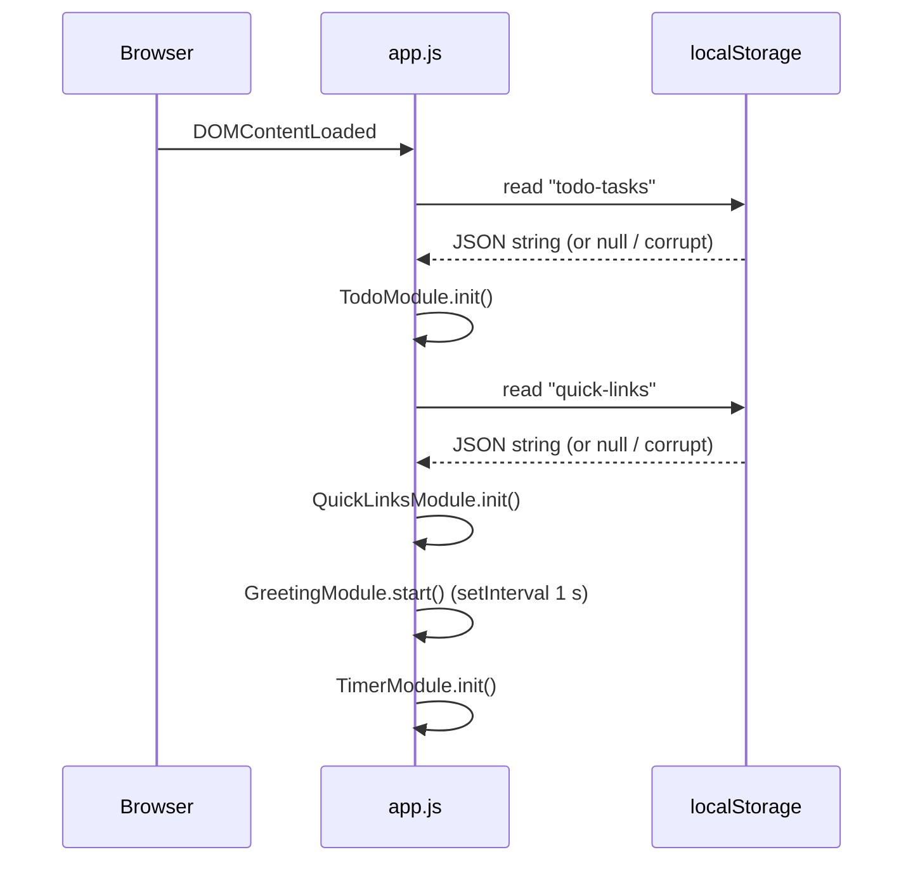
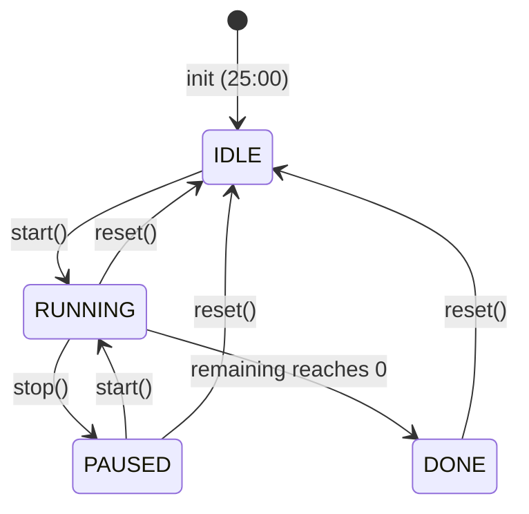

# Design Document: To-Do List Life Dashboard

## Overview

The To-Do List Life Dashboard is a single-page web application delivered as a static HTML file with one companion CSS file and one companion JavaScript file. It requires no build step, no server, and no external dependencies. The user opens `index.html` directly in any modern browser and the app is immediately usable, with all state persisted to `localStorage`.

The dashboard is divided into four independent, self-contained sections:

| Section | Purpose |
|---|---|
| Greeting | Live clock (HH:MM:SS), current date, time-of-day greeting |
| Focus Timer | 25-minute Pomodoro countdown with Start / Stop / Reset controls |
| To-Do List | Create, read, update, delete, and persist tasks |
| Quick Links | Create and persist labeled URL shortcut buttons (max 20) |

Each section operates independently; a failure or error in one section must not affect the others.

---

## Architecture

The entire application follows a **Module Pattern** implemented inside a single `js/app.js` file. There is no bundler, so modules are simulated with immediately-invoked function expressions (IIFEs) and a lightweight event bus for cross-section communication.

```
index.html
├── css/style.css          (all styling, including responsive layout and WCAG contrast)
└── js/app.js              (all behavior, split into logical module objects)
    ├── StorageService     – thin wrapper around localStorage (read/write/clear)
    ├── GreetingModule     – clock tick, date formatting, greeting logic
    ├── TimerModule        – countdown state machine, interval management
    ├── TodoModule         – task CRUD, validation, render, persistence
    └── QuickLinksModule   – link CRUD, validation, render, persistence
```

### Initialization Flow



### State Management

All mutable state lives inside the owning module. There is no shared global state. Each module exposes a plain-object API (not a class) for easier testability.

---

## Components and Interfaces

### StorageService

Thin wrapper that centralises all `localStorage` access so the rest of the code never calls `localStorage` directly. This makes the module boundary easy to mock in tests.

```js
StorageService = {
  read(key)          // → parsed object | null
  write(key, value)  // → void  (serialises to JSON)
  remove(key)        // → void
}
```

`read` returns `null` when the key is absent **or** when the stored string is not valid JSON (the error is swallowed and a console warning is emitted).

---

### GreetingModule

Responsible for the live clock, date string, and greeting text.

**Public API:**
```js
GreetingModule = {
  start()  // begins setInterval(tick, 1000), calls tick() immediately
  tick()   // reads Date.now(), updates DOM elements
}
```

**Greeting logic (pure function, easily testable):**

```js
function getGreeting(hour) {
  if (hour >= 5  && hour <= 11) return "Good Morning";
  if (hour >= 12 && hour <= 17) return "Good Afternoon";
  return "Good Evening";            // 18–23 and 00–04
}
```

**Date formatting (pure function):**

```js
// Returns "Monday, 26 October 2025"
function formatDate(date) { ... }
```

**Rationale:** Keeping `getGreeting` and `formatDate` as pure functions decoupled from the DOM makes them directly unit-testable without a browser environment.

---

### TimerModule

Implements a finite-state machine for the countdown timer.

**States:**



**Public API:**
```js
TimerModule = {
  init()   // sets state = IDLE, remaining = 1500 s, renders display
  start()  // IDLE|PAUSED → RUNNING; no-op if RUNNING or DONE
  stop()   // RUNNING → PAUSED; no-op otherwise
  reset()  // any state → IDLE; clears interval, resets to 1500 s
  tick()   // called by internal setInterval every 1000 ms
}
```

**Interval safety:** A single `intervalId` variable is stored in module scope. `start()` clears any existing interval before creating a new one, guaranteeing no duplicate intervals even if the browser delays calls.

**Control state table:**

| Timer state | Start btn | Stop btn |
|---|---|---|
| IDLE | enabled | disabled |
| RUNNING | disabled | enabled |
| PAUSED | enabled | disabled |
| DONE | disabled | disabled |

---

### TodoModule

Manages an ordered array of Task objects.

**Task data shape:**
```js
{ id: string, description: string, completed: boolean }
```

`id` is generated via `Date.now().toString(36) + Math.random().toString(36).slice(2)` — collision-free for single-user local use.

**Public API:**
```js
TodoModule = {
  init()                              // load from storage, render
  addTask(description)                // validate → push → persist → render
  editTask(id, newDescription)        // validate → mutate → persist → render
  toggleTask(id)                      // flip completed → persist → render
  deleteTask(id)                      // remove → persist → render
  _validate(description)              // → { valid: boolean, error: string|null }
  _persist()                          // serialise tasks → StorageService.write
  _render()                           // full re-render of task list DOM
}
```

**Validation rules (pure function):**
- Trimmed length === 0 → error: "Task description cannot be empty."
- Trimmed length > 200 → error: "Task description must be 200 characters or fewer."

---

### QuickLinksModule

Manages an ordered array of Link objects with a hard cap of 20.

**Link data shape:**
```js
{ id: string, label: string, url: string }
```

**Public API:**
```js
QuickLinksModule = {
  init()                  // load from storage, render
  addLink(label, url)     // validate → push → persist → render
  deleteLink(id)          // remove → persist → render
  _validateLabel(label)   // → { valid: boolean, error: string|null }
  _validateUrl(url)       // → { valid: boolean, error: string|null }
  _normaliseUrl(url)      // prepend "https://" if no http(s) scheme
  _persist()              // serialise links → StorageService.write
  _render()               // full re-render of links DOM
}
```

**URL normalisation (pure function):**
```
input "example.com"        → "https://example.com"
input "http://example.com" → "http://example.com"  (unchanged)
input "https://foo.bar"    → "https://foo.bar"      (unchanged)
```

**Validation rules:**
- Label trimmed length === 0 → error: "Label cannot be empty."
- URL trimmed length === 0 → error: "URL cannot be empty."
- After normalisation, URL does not start with `http://` or `https://` → error: "URL must start with http:// or https://."

---

## Data Models

### localStorage Keys

| Key | Type | Description |
|---|---|---|
| `"todo-tasks"` | `Task[]` | Ordered array of task objects |
| `"quick-links"` | `Link[]` | Ordered array of link objects |

### Task Object

```ts
interface Task {
  id: string;           // unique opaque identifier
  description: string;  // 1–200 characters (trimmed)
  completed: boolean;
}
```

### Link Object

```ts
interface Link {
  id: string;           // unique opaque identifier
  label: string;        // 1–50 characters
  url: string;          // normalised, starts with http:// or https://
}
```

### Serialisation Contract

- Tasks are serialised as a JSON array: `[{ id, description, completed }, ...]`
- Links are serialised as a JSON array: `[{ id, label, url }, ...]`
- Both arrays preserve insertion order.
- A round-trip (serialise → deserialise) must produce a collection where every item's `description`/`label`/`url`/`completed` fields are byte-identical to the originals.

---

## Correctness Properties

*A property is a characteristic or behavior that should hold true across all valid executions of a system — essentially, a formal statement about what the system should do. Properties serve as the bridge between human-readable specifications and machine-verifiable correctness guarantees.*

### Property 1: Task serialisation round-trip

*For any* array of Task objects (with arbitrary valid descriptions and completion states), serialising the array to JSON and then deserialising it SHALL produce a collection where every task has an identical `description` and `completed` value as the original.

**Validates: Requirements 6.5**

---

### Property 2: Link serialisation round-trip

*For any* array of Link objects (with arbitrary valid labels and URLs), serialising the array to JSON and then deserialising it SHALL produce a collection where every link has an identical `label` and `url` as the original.

**Validates: Requirements 9.5**

---

### Property 3: Whitespace task descriptions are always rejected

*For any* string composed entirely of whitespace characters (spaces, tabs, newlines), calling `TodoModule._validate()` on it SHALL return `{ valid: false }`, and the task list SHALL remain unchanged after an attempted add or edit using that description.

**Validates: Requirements 3.3, 4.4**

---

### Property 4: Over-length task descriptions are always rejected

*For any* task description string whose trimmed length exceeds 200 characters, calling `TodoModule._validate()` on it SHALL return `{ valid: false }`, and the task list SHALL remain unchanged after an attempted add or edit using that description.

**Validates: Requirements 3.4, 4.5**

---

### Property 5: URL normalisation idempotence

*For any* URL that already begins with `"http://"` or `"https://"`, applying `_normaliseUrl()` SHALL return the URL unchanged. *For any* URL that does not begin with a recognised scheme, applying `_normaliseUrl()` twice SHALL produce the same result as applying it once.

**Validates: Requirements 7.5**

---

### Property 6: Greeting coverage is total and non-overlapping

*For any* integer hour in the range 0–23 (inclusive), `getGreeting(hour)` SHALL return exactly one of `"Good Morning"`, `"Good Afternoon"`, or `"Good Evening"` — never `null`, never `undefined`, and no hour maps to more than one greeting.

**Validates: Requirements 1.3, 1.4, 1.5**

---

### Property 7: Valid task addition grows the list by exactly one

*For any* current task list and any valid task description (non-empty, ≤ 200 characters after trimming), calling `addTask()` SHALL increase the length of the task list by exactly one, and the last element in the list SHALL have the submitted description (trimmed) and `completed: false`.

**Validates: Requirements 3.2**

---

### Property 8: Task toggle is an involution

*For any* task in the list, toggling its completion state twice (complete then incomplete, or incomplete then complete) SHALL leave the task's `completed` field equal to its original value, and all other fields unchanged.

**Validates: Requirements 5.2, 5.3**

---

### Property 9: Quick Links cap is enforced under all addition sequences

*For any* sequence of valid `addLink()` calls, the length of the links collection SHALL never exceed 20, regardless of the number or order of additions.

**Validates: Requirements 7.8**

---

## Error Handling

### StorageService Errors

| Scenario | Handling |
|---|---|
| `localStorage` not available (private mode, storage full) | `write()` catches the `DOMException` and emits a `console.warn`; the in-memory state is still updated so the UI remains functional for the session |
| Corrupt / non-JSON value on `read()` | Returns `null`; calling module renders empty list and shows a non-blocking notice in the UI |
| Key absent | Returns `null`; calling module renders empty list silently |

### Validator Errors

Inline error messages are inserted adjacent to the offending input field using a `<span class="error-msg">` element. The element is cleared on the next valid submission or when the user begins typing (via `input` event listener).

### Timer Edge Cases

- `reset()` called while timer is `RUNNING`: the active interval is cleared atomically before resetting state, preventing a final `tick()` from firing after reset.
- `start()` called while already `RUNNING`: guarded by a state check; no duplicate interval is created.
- `tick()` fires after `remaining` reaches 0: the DONE state check inside `tick()` prevents the display from going negative.

### Quick Links Edge Cases

- Addition attempted when 20 links already exist: the Add button is disabled in the DOM; a defensive check in `addLink()` also returns early and shows the cap message.
- URL normalisation with a completely blank URL: handled by the empty-URL validator before normalisation is attempted.

---

## Testing Strategy

### Overview

The testing strategy uses two complementary approaches:

1. **Unit tests** — verify specific examples, edge cases, and error conditions for pure functions.
2. **Property-based tests** — verify universal properties across randomly generated inputs.

Both run in the browser (or a jsdom environment) with no build step required. The recommended testing library is **[fast-check](https://github.com/dubzzz/fast-check)** for property-based testing, loaded via a CDN `<script>` tag in a standalone `test/index.html` runner page. For the unit test harness, **[QUnit](https://qunitjs.com/)** is a zero-dependency option that also loads from CDN and works without a build tool — consistent with the project's no-build-tools constraint.

### Unit Tests

Focus areas:

- `getGreeting()` — all 24 hour values, boundary hours (5, 12, 18, 0, 4, 11, 17, 23)
- `formatDate()` — representative dates including month/day name formatting
- `TodoModule._validate()` — empty string, whitespace-only strings, strings at exactly 200 chars, strings at 201 chars, normal valid strings
- `QuickLinksModule._validateLabel()` / `_validateUrl()` — empty inputs, boundary lengths
- `QuickLinksModule._normaliseUrl()` — already-prefixed URLs, bare domains, edge cases
- `TimerModule` state transitions — each valid and invalid transition
- `StorageService.read()` — absent key, corrupt JSON, valid JSON

### Property-Based Tests (fast-check)

Each property test is tagged with a comment referencing the design property it verifies. Minimum 100 iterations per property (fast-check default is 100 runs).

| Property | fast-check arbitraries | Tag |
|---|---|---|
| Property 1: Task serialisation round-trip | `fc.array(fc.record({ id: fc.string(), description: fc.string({minLength:1, maxLength:200}), completed: fc.boolean() }))` | `Feature: todo-life-dashboard, Property 1` |
| Property 2: Link serialisation round-trip | `fc.array(fc.record({ id: fc.string(), label: fc.string({minLength:1, maxLength:50}), url: fc.webUrl() }))` | `Feature: todo-life-dashboard, Property 2` |
| Property 3: Whitespace task descriptions rejected | `fc.stringOf(fc.constantFrom(' ', '\t', '\n', '\r'))` | `Feature: todo-life-dashboard, Property 3` |
| Property 4: Over-length descriptions rejected | `fc.string({ minLength: 201 })` | `Feature: todo-life-dashboard, Property 4` |
| Property 5: URL normalisation idempotence | `fc.webUrl()` and `fc.string()` | `Feature: todo-life-dashboard, Property 5` |
| Property 6: Greeting coverage — total and non-overlapping | `fc.integer({ min: 0, max: 23 })` | `Feature: todo-life-dashboard, Property 6` |
| Property 7: Valid add grows list by one | `fc.array(taskArb)` + `fc.string({ minLength:1, maxLength:200 })` | `Feature: todo-life-dashboard, Property 7` |
| Property 8: Toggle is involution | `fc.array(taskArb, { minLength:1 })` + `fc.nat()` (index) | `Feature: todo-life-dashboard, Property 8` |
| Property 9: Links cap enforced | `fc.array(linkArb, { minLength:21, maxLength:50 })` | `Feature: todo-life-dashboard, Property 9` |

### Integration / Smoke Tests

- Load `index.html` in each target browser; verify no JS console errors on first load.
- Load with an empty `localStorage`; verify all four sections render correctly.
- Load with pre-seeded `localStorage` data; verify tasks and links restore in correct order.
- Load with corrupt `localStorage` values; verify non-blocking notices appear and sections render empty lists.

### Responsiveness

Manual visual checks at breakpoints: 320px, 375px, 768px, 1024px, 1280px, 1920px. Confirm no horizontal overflow and no overlapping content at any width.

### Accessibility

- Automated: run axe-core against `index.html` to catch WCAG 2.1 AA violations programmatically.
- Manual: keyboard-navigate through all interactive controls (tab order, Enter/Space activation, visible focus indicators).
- Manual: verify contrast ratios for all text/background colour pairs using a colour contrast checker tool.
